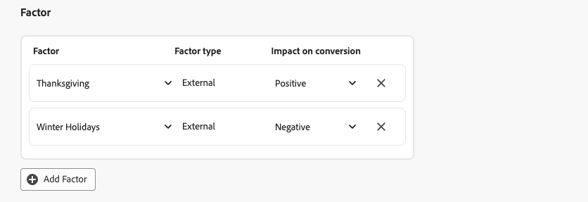
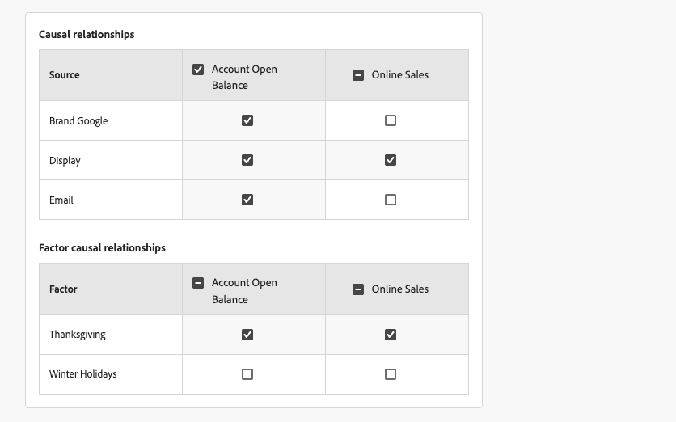
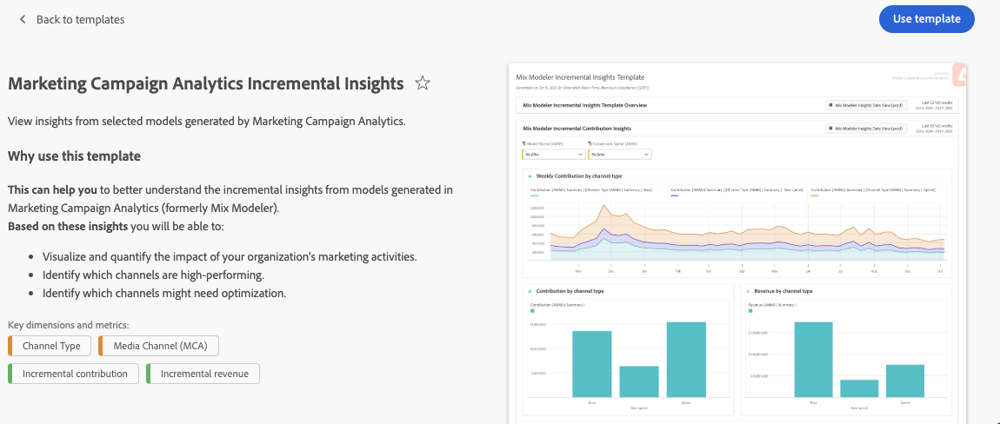

# Criar modelos

{{mm-mca-rebranding}}

Para criar modelos alimentados por IA personalizada, a interface fornece um fluxo de configuração de modelo guiado passo a passo.

Na interface  **[!UICONTROL Models]** em [!DNL Marketing Campaign Analytics], selecione **[!UICONTROL Open model canvas]**.

## Configurar

Você define um nome e uma descrição na etapa **[!UICONTROL Setup]**:

1. Insira seu modelo **[!UICONTROL Name]**, por exemplo `Demo model`. Digite um **[!UICONTROL Description]**, por exemplo `Demo model to explore AI features of Marketing Campaign Analytics`.

   

1. Selecione **[!UICONTROL Next]** para continuar com a próxima etapa. Selecione **[!UICONTROL Cancel]** para cancelar a configuração do modelo.

## Configurar {#configure}

>[!CONTEXTUALHELP]
>id="model_marketingtouchpoints_select"
>title="Pontos de contato de marketing"
>abstract="Pontos de contato de marketing são eventos de marketing a nível de destinatário, pessoa e/ou cookie usados para avaliar o impacto dos investimentos em marketing nas conversões numéricas ou baseadas em receita.  Não é possível configurar o modelo com pontos de contato que tenham dados sobrepostos e é necessário haver pelo menos um ponto de contato com gastos."

Configure seu modelo na etapa **[!UICONTROL Configure]**. A configuração envolve a ativação da modelagem completa do funnel, a definição de metas de conversão, pontos de contato de marketing, a população de dados elegível, fatores externos e internos e muito mais.

1. Se você deseja habilitar a [modelagem completa do funnel](./overview.md#full-funnel-modeling), na seção **[!UICONTROL Full funnel model]**:

   1. Selecione **[!UICONTROL Enable full funnel modeling]**.
   1. Selecione uma conversão superior no menu suspenso **[!UICONTROL Upper funnel conversion]**.

1. Na seção **[!UICONTROL Conversion goal]**:

   

   1. Selecione uma conversão no menu suspenso **[!UICONTROL Conversion]**. As conversões disponíveis são aquelas que você definiu como parte de [Conversões](../harmonize-data/conversions.md) em [!UICONTROL Harmonized datasets]. Por exemplo, **[!UICONTROL Online Conversion]**.

   1. Você pode selecionar  **[!UICONTROL Create a conversion]** para criar uma conversão diretamente da configuração do modelo.

1. Na seção **[!UICONTROL Marketing touchpoints]**, você pode selecionar um ou mais pontos de contato de marketing, correspondentes aos pontos de contato de marketing definidos como parte dos [Pontos de contato de marketing](../harmonize-data/marketing-touchpoints.md) em [!UICONTROL Harmonized datasets].

   

   1. Selecione um ou mais pontos de contato de marketing no menu suspenso **[!UICONTROL Touchpoint include]**.

      * Você pode usar  para remover um ponto de contato.
      * Você pode usar **[!UICONTROL Clear all]** para remover todos os pontos de contato.

   1. Você pode selecionar  **[!UICONTROL Create a touchpoint]** para criar um ponto de contato de marketing diretamente da configuração do modelo.

   >[!NOTE]
   >
   >Você não pode configurar o modelo com pontos de contato que tenham dados sobrepostos e deve haver pelo menos um ponto de contato com gasto.

1. Por padrão, uma pontuação é gerada para todos os dados na visualização harmonizada. Para pontuar apenas um subconjunto da população, defina um ou mais filtros usando contêineres na seção **[!UICONTROL Eligible data population]**.

   

   * Para cada container, defina um ou mais eventos.

     1. Para cada evento:

        1. Selecione uma métrica ou dimensão em **[!UICONTROL _Selecionar campo harmonizado_]**.

        1. Selecione o operador apropriado: **[!UICONTROL equals]**, **[!UICONTROL not equals]**, **[!UICONTROL less than]**, **[!UICONTROL greater than]**, **[!UICONTROL starts with]**, **[!UICONTROL doesn't start with]**, **[!UICONTROL ends with]**, **[!UICONTROL doesn't end with]**, **[!UICONTROL contains]**, **[!UICONTROL doesn't contain]**, **[!UICONTROL is in]** ou **[!UICONTROL is not in]**.

        1. Insira ou selecione um valor em **[!UICONTROL _Insira ou selecione o valor_]**.

     1. Para adicionar outro evento ao contêiner, selecione  **[!UICONTROL Add event]**.

     1. Para remover um evento do container, selecione .

     1. Para filtrar usando todos ou alguns dos vários eventos definidos no container, selecione **[!UICONTROL Any of]** ou **[!UICONTROL All of]**. O rótulo foi alterado de **[!UICONTROL Include ... Or ...]** para **[!UICONTROL Include ... And ...]**.

   * Para adicionar um contêiner de preenchimento de dados qualificado, selecione  **[!UICONTROL Add eligible population]**.

   * Para remover um contêiner de preenchimento de dados qualificado, no contêiner, selecione  e selecione **[!UICONTROL Remove container]** no menu de contexto.

   * Selecione **And** e **Or** entre contêineres para criar definições mais complexas para a população de dados qualificada.

1. Você pode gerenciar conjuntos de dados contendo fatores internos ou externos na seção **[!UICONTROL Factor]**.

   * Para adicionar um conjunto de dados de fator, selecione **[!UICONTROL Add Factor]**. É possível adicionar no máximo 30 fatores a um modelo.

     

     1. Selecione um **[!UICONTROL Factor dataset]** no menu suspenso. Os fatores disponíveis são os fatores para os quais você definiu um campo harmonizado em [regras do conjunto de dados](/help/harmonize-data/dataset-rules.md#create-a-dataset-rule).

        Com base no conjunto de dados selecionado, o **[!UICONTROL Factor type]** é **[!UICONTROL Internal]** ou **[!UICONTROL External]**.

     1. Selecione o **[!UICONTROL Impact on conversion]** no menu suspenso. As opções disponíveis são: **[!UICONTROL Auto]**, **[!UICONTROL Positive]** ou **[!UICONTROL Negative]**. A opção padrão é **[!UICONTROL Auto]**, que permite que o modelo determine o impacto do conjunto de dados do fator.

   * Para excluir um conjunto de dados de fator, selecione .

   * Se seu modelo estiver habilitado para [modelagem completa de funnel](./overview.md#full-funnel-modeling), você precisará definir relações causais e relações causais de fatores para os fatores adicionados ao modelo.

     

     * Para definir relações causais, na tabela **[!UICONTROL Causal relationship]** s, selecione  para cada canal (**[!UICONTROL Source]**) para indicar se o canal influencia os KPIs de conversão superior e inferior.

       Você pode selecionar  o cabeçalho da coluna para KPI de conversão superior e KPI de conversão inferior para definir rapidamente que todos os canais influenciam o KPI.

     * Ao definir fatores, você define relacionamentos causais de fatores. Para definir relações causais de fator, na tabela **[!UICONTROL Factor causal relationships]**, selecione  para cada fator (**[!UICONTROL Factor]**) para indicar se o fator influencia os KPIs de conversão superior e inferior.

       Você pode selecionar  o cabeçalho da coluna para KPI de conversão superior e KPI de conversão inferior para definir rapidamente que todos os fatores influenciam o KPI.

1. Para definir a janela de lookback do modelo, insira um valor entre `1` e `52` em **[!UICONTROL Give contribution credit to touchpoints occurring within]** ... **[!UICONTROL weeks prior to the conversion]** na seção **[!UICONTROL Define lookback window]**.

   Se seu modelo estiver habilitado para [modelagem completa do funnel](./overview.md#full-funnel-modeling):

   * Para definir a janela de retrospectiva do funnel inferior, insira um valor entre `1` e `52` em **[!UICONTROL Give contribution credit to touchpoints occurring within]** ... **[!UICONTROL weeks prior to the conversion]** para **[!UICONTROL Lower funnel]** na seção **[!UICONTROL Define lookback window]**.

   * Para definir a janela de pesquisa para o funnel superior, insira um valor entre `1` e `52` em **[!UICONTROL Give contribution credit to touchpoints occurring within]** ... **[!UICONTROL weeks prior to the upper funnel conversion]** para **[!UICONTROL Upper funnel]** na seção **[!UICONTROL Define lookback window]**.

1. Para definir a janela de treinamento para um modelo, em **[!UICONTROL Define training window]**, selecione onde começar a pontuar conversões.

   

   Você pode selecionar entre:

   * **[!UICONTROL Have Marketing Campaign Analytics select a helpful training window]** e

   * **[!UICONTROL Manually input a training window]**. Quando selecionado, defina o número de anos em **[!UICONTROL Include events the following years prior to a conversion]**.

   Essa entrada é necessária para um modelo. O número de anos determina como o canal adstock, que você pode configurar na etapa **[!UICONTROL Advanced]**, é limitado.

1. Selecione **[!UICONTROL Next]** para continuar com a próxima etapa. Se forem necessárias mais configurações, um contorno vermelho e um texto explicarão qual configuração adicional será necessária.  Selecione **[!UICONTROL Back]** para voltar à etapa anterior.  Selecione **[!UICONTROL Cancel]** para cancelar a configuração do modelo.

## Avançado {#advanced}

>[!CONTEXTUALHELP]
>id="model_advanced_channeladstock"
>title="Adstock do canal"
>abstract="Incorpore experiência em domínios, resultados de experimentação ou análises de canal anteriores diretamente na configuração do modelo. A configuração do Adstock ajuda a orientar o modelo para se alinhar às expectativas do mundo real e melhora a capacidade de interpretação e a confiança no resultado. O total de semanas de retrospectiva mais semanas de atraso por canal é limitado a um oitavo da janela de treinamento configurada. Esse limite permite obter dados suficientes para que o modelo aprenda os efeitos adstock."

Você pode especificar configurações avançadas na etapa **[!UICONTROL Advanced]**. Nesta etapa, você pode definir [gastar compartilhamento](#spend-share), habilitar seu modelo para [atribuição multitoque (MTA)](#mta), definir [conhecimento anterior](#prior-knowledge) e definir [estoque de canais](#channel-adstock).

### Gastar compartilhamento

Na seção **[!UICONTROL Spend share]**:

* Para usar taxas históricas de investimento em marketing para informar o modelo quando os dados de marketing são escassos, ative **[!UICONTROL Allow spend share]**.

  Se seu modelo estiver habilitado para [modelagem completa do funnel](./overview.md#full-funnel-modeling):

  * Para usar taxas históricas de investimento em marketing para informar o modelo quando os dados de marketing são escassos, ative **[!UICONTROL Allow spend share for the lower funnel]**.
  * Para usar taxas históricas de investimento em marketing para informar o modelo quando os dados de marketing são escassos, ative **[!UICONTROL Allow spend share for the upper funnel]**.

* Essa configuração é recomendada, especialmente nos seguintes cenários:
  * Um canal não tem observações suficientes (por exemplo, baixa frequência de gastos, impressões ou cliques).
  * Você está modelando mídia pontual, mas regular e potencialmente de alto gasto (como TV para algumas marcas), em que os dados são escassos.

  >[!NOTE]
  >
  >Para investimentos únicos (por exemplo, um anúncio de Super Bowl), incorpore esses dados como um fator em vez de depender da participação nos gastos.
  >

### MTA

Na seção **[!UICONTROL MTA enabled]**:

* Para habilitar recursos de MTA para o modelo, ative **[!UICONTROL MTA enabled]**. Se você tiver ativado o MTA, os insights de atribuição multitoque estarão disponíveis após treinar e pontuar seu modelo. Consulte a guia [Atribuição](insights.md#attribution) em [Insights de modelo](insights.md).

### Conhecimento prévio

Na seção **[!UICONTROL Prior knowledge]**:

1. Selecione o **[!UICONTROL Rule type]**, que é por padrão **[!UICONTROL Absolute values]**.

1. Se seu modelo estiver habilitado para [modelagem completa do funnel](./overview.md#full-funnel-modeling):

   * Selecione **[!UICONTROL Lower funnel]** ou **[!UICONTROL Upper funnel]** de **[!UICONTROL Select metric]** como a métrica do funnel a ser usada para conhecimento prévio.

1. Especifique porcentagens de contribuição para qualquer um dos canais listados em **[!UICONTROL Name]**, usando a coluna **[!UICONTROL Contribution proportion]**.

1. Quando apropriado, você pode adicionar uma porcentagem de **[!UICONTROL Level of confidence]** para cada canal.

1. Quando necessário, use **[!UICONTROL Clear all]** para limpar todos os valores de entrada para as colunas **[!UICONTROL Contribution proportion]** e **[!UICONTROL Level of confidence]**.

### Adstock do canal

Na seção **[!UICONTROL Channel adstock]**, é possível definir retrospectivas individuais do adstock (efeitos de transferência ou de decaimento) e atraso (tempo de resposta atrasado) para cada canal (canal de marketing) definido em seu modelo.

Essa configuração de canal adstock permite um controle refinado sobre como diferentes canais de marketing afetam os resultados dos negócios ao longo do tempo. Como alternativa, você pode usar os padrões do sistema e uma configuração padrão.

A configuração do adstock de canal ajuda a capturar nuances específicas de canais. Por exemplo, o impacto duradouro das campanhas de TV, o impacto de curta duração da pesquisa paga ou o atraso entre o gasto do influenciador e as conversões observáveis. Experimente com parâmetros de retrospectiva e de atraso do adstock para gerar insights mais precisos, personalizados e confiáveis. Em última análise, uma configuração de adstock de canal pode levar a alocações de orçamento mais precisas e a melhores decisões de negócios.

Para configurar o adstock de canal:

* Se seu modelo estiver habilitado para [modelagem completa do funnel](./overview.md#full-funnel-modeling), selecione **[!UICONTROL Lower funnel]** ou **[!UICONTROL Upper funnel]** de **[!UICONTROL Select metric]** como a métrica do funnel a ser usada para o adstock de canal.

* Para cada canal (**[!UICONTROL Name]**), defina um valor **[!UICONTROL Lag (weeks)]**, **[!UICONTROL Min Lookback (weeks)]** e **[!UICONTROL Max Lookback (weeks)]**. Para cada valor:

  * Para aumentar um valor, use ; para diminuir um valor, use ; ou insira um valor manualmente.

  O total de semanas de atraso mais o máximo de semanas de retrospectiva por canal é limitado a um oitavo da janela de treinamento configurada. Esse limite permite obter dados suficientes para que o modelo aprenda os efeitos adstock. Por exemplo, para um período de treinamento de dois anos, o máximo de **[!UICONTROL Lag (weeks)]** e **[!UICONTROL Lookback (weeks)]** para um canal é de 13 semanas. Esse limite é aplicado ao definir os valores.

* Para redefinir todos os adstock de canal para os padrões:

  * Selecione **[!UICONTROL Reset to defaults]**.

## Definir opções

Você pode [agendar treinamento e pontuação](#schedule) e especificar [campos de relatórios de insights granulares](#granular-insights-reporting-fields) para seu modelo na etapa **[!UICONTROL Set options]**.

### Cronograma

Na seção **[!UICONTROL Schedule]**, você pode agendar o treinamento e a pontuação do modelo.

Para programar a pontuação e o treinamento do modelo:

1. Ligue o **[!UICONTROL Enable scheduled model scoring and training]**.
1. Selecione um **[!UICONTROL Scoring frequency]**:

   * **[!UICONTROL Daily]**: Insira uma hora válida (por exemplo `05:22 pm`) ou use  para definir a hora.
   * **[!UICONTROL Weekly]**: Selecione um dia da semana e insira uma hora válida (por exemplo `05:22 pm`) ou use  para definir a hora.
   * **[!UICONTROL Monthly]**: Selecione um dia do mês no menu suspenso Executar em cada e insira um horário válido (por exemplo `05:22 pm`) ou use  para definir o horário.

1. Selecione um **[!UICONTROL Training frequency]** no menu suspenso: **[!UICONTROL Monthly]**, **[!UICONTROL Quarterly]**, **[!UICONTROL Yearly]** ou **[!UICONTROL None]**.

### Customer Journey Analytics {#cja}

>[!CONTEXTUALHELP]
>id="model_enable_cja"
>title="Habilitar o Customer Journey Analytics"
>abstract="Para disponibilizar dados de pontuação para o Customer Journey Analytics para relatórios e análises, habilite essa configuração. Depois de habilitada, é necessário excluir o modelo para desabilitar essa configuração."

{{release-limited-testing-section}}

Quando você tiver direito ao Customer Journey Analytics e tiver criado uma ou mais [regras do conjunto de dados](/help/harmonize-data/dataset-rules.md) para o Marketing Campaign Analytics em uma sandbox específica:

* Dois conjuntos de dados dedicados do Marketing Campaign Analytics são criados na sandbox da Experience Platform.
* É criada uma [conexão](https://experienceleague.adobe.com/pt-br/docs/analytics-platform/using/cja-connections/overview) do Customer Journey Analytics, denominada **[!UICONTROL Marketing Campaign Analytics Enabled Connection (_sandbox-name _)]**, que contém os conjuntos de dados dedicados do Marketing Campaign Analytics.
* Uma [exibição de dados](https://experienceleague.adobe.com/pt-br/docs/analytics-platform/using/cja-dataviews/data-views) do Customer Journey Analytics, denominada **[!UICONTROL Marketing Campaign Analytics Insights Data View (_sandbox-name _)]**, é criada com base na conexão.

A conexão e a visualização de dados são de propriedade do sistema. Não é possível atualizar ou excluir a conexão ou a visualização de dados.

Para disponibilizar os dados de pontuação do modelo para a Customer Journey Analytics por meio de conjuntos de dados, conexão e visualização de dados mencionados acima:

* Selecione **[!UICONTROL Enable scores for Customer Journey Analytics]**.

  Depois de habilitar essa configuração, você só poderá desabilitá-la excluindo o modelo.

Para relatar e analisar os dados do Marketing Campaign Analytics rapidamente, em um [projeto do espaço de trabalho](https://experienceleague.adobe.com/pt-br/docs/analytics-platform/using/cja-workspace/home) do Customer Journey Analytics:

1. Selecione **[!UICONTROL Workspace]** > **[!UICONTROL Adobe templates]**.
1. Selecione o **[!UICONTROL Marketing Campaign Analytics Insights Data View (_sandbox-name _)]**&#x200B;dedicado como a exibição de dados a ser usada para um projeto.
1. Selecione o **[!UICONTROL Marketing Campaign Analytics Incremental Insights]** [modelo](https://experienceleague.adobe.com/en/docs/analytics-platform/using/cja-workspace/templates/use-templates#marketing-campaign-analytics-templates).
   * Selecione **[!UICONTROL Preview]** para ver uma visualização.

     
   * Selecione **[!UICONTROL Use template]** para criar um projeto baseado no modelo.

### Campos de relatório de insights granulares

A seção **[!UICONTROL Granular insights reporting fields]** usa a funcionalidade de relatório de incrementalidade granular. Essa funcionalidade permite selecionar campos harmonizados para analisar pontuações de conversão e incrementalidade de ponto de contato.

Você define esses campos harmonizados para poder detalhar os relatórios do seu modelo usando colunas de relatórios granulares em vez de precisar criar modelos separados.

Por exemplo, você cria um modelo focado na receita, mas também tem interesse no desempenho da campanha, do tipo de mídia, da região e da fonte de tráfego. Sem a funcionalidade de relatório de incrementalidade granular, é necessário criar quatro modelos separados. Com a funcionalidade de relatórios de incrementalidade granular, você pode detalhar seu modelo de receita em campanhas, tipos de mídia, regiões e fontes de tráfego.

1. Selecione um ou mais campos harmonizados em **[!UICONTROL _Selecionar campos harmonizados_]** abaixo de **[!UICONTROL Includes]**. Os campos harmonizados selecionados são adicionados ao painel.
1. Selecione **[!UICONTROL *Campo harmonizado *]** para remover um campo harmonizado do contêiner com os campos harmonizados selecionados.
1. Selecione **[!UICONTROL Clear all]** para remover todos os campos harmonizados selecionados.

Os campos harmonizados selecionados para relatórios de incrementalidade granular estão disponíveis como parte do [esquema](/help/ingest-data/schemas.md) e do [conjunto de dados](/help/ingest-data/datasets.md) do Experience Platform que resulta da pontuação do modelo. Os campos de relatórios de insights granulares podem ser encontrados dentro dos objetos **[!UICONTROL conversionPassthrough]** e **[!UICONTROL touchpointPassthrough]**.

## Concluir

* Selecione **[!UICONTROL Finish]** para concluir a configuração do modelo.

  * Na caixa de diálogo **[!UICONTROL Create instance?]**, selecione **[!UICONTROL Ok]** para acionar o primeiro conjunto de treinamentos e execuções de pontuação imediatamente. Seu modelo está listado com o status  **[!UICONTROL Awaiting training]**.

    Selecione **[!UICONTROL Cancel]** para cancelar.

  * Se forem necessárias mais configurações, um contorno vermelho e um texto explicarão qual configuração adicional será necessária.

* Selecione **[!UICONTROL Back]** para voltar à etapa anterior.

* Selecione **[!UICONTROL Cancel]** para cancelar a configuração do modelo.

